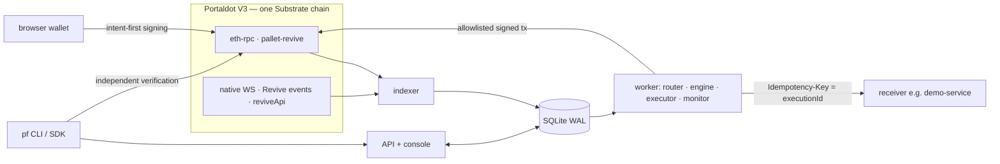

# PortalForge

**Build, observe, and automate on Portaldot.**
面向 Portaldot V3 的应用开发、链上观测与可恢复自动化平台。

PortalForge is open-source middleware for teams shipping applications on Portaldot V3. One product loop:
**deploy** contracts with a simulation and an exact storage-deposit preview, **index** EVM logs *and* native runtime events, **automate** with versioned workflows, **recover** from lost responses / crashed workers / RPC outages without duplicating business effects, and **verify** deployments and execution evidence against the chain.

> **Status (2026-11-04).** Everything runs and is tested locally; live Portaldot V3 is probed, simulated and indexed read-only.
> **PortalForge contracts are not yet deployed to the testnet** — the deploy is prepared and waits for testnet tPOT ([docs/funding-handoff.md](docs/funding-handoff.md)). Local results use Anvil (plain EVM) and are **not** testnet evidence.

**Try it without installing anything:** [project page with video and deck](https://adrian001-crypt.github.io/portalforge/) · [read-only demo](https://adrian001-crypt.github.io/portalforge/demo/). The video and demo use a local Anvil chain and say so. Screenshots: [docs/media/screenshots](docs/media/screenshots). Pitch deck: [PDF](docs/pitch/portalforge-pitch.pdf).

## The problem

On Portaldot V3, Solidity runs inside **pallet-revive** on a Substrate chain. That means:

- every contract event exists twice — an EVM log and a native `Revive.ContractEmitted` event — and EVM tools cannot see dispatch errors or runtime versions while Substrate tools cannot decode ABIs;
- code and storage carry **deposits** (~0.06 tPOT per byte; a 2 KB contract holds ~160 tPOT) hidden inside “gas”;
- native tPOT has 14 decimals but appears with 18 on the EVM side; SS58 and H160 accounts are different identities;
- the public eth-rpc has no `eth_newFilter`, so event-driven automation must be built on polling;
- automation glued from scripts and webhooks duplicates or loses work when a response is lost or a worker dies.

## Why Portaldot — V3 capabilities PortalForge actually uses

Measured on the live testnet (details and raw output: [docs/network-capabilities.md](docs/network-capabilities.md), [docs/probe/](docs/probe/)):

| V3 capability | Used for |
|---|---|
| pallet-revive eth-rpc, `allowEVMBytecode=true`, Cancun opcodes | Template contracts compiled with solc 0.8.28 / cancun; every create simulated with `eth_call`, runtime must equal the artifact |
| `reviveApi.instantiate` runtime API | **Exact storage deposit** before signing (JobRegistry 161.04 tPOT, EvidenceRegistry 176.09 tPOT, one storage slot 3.8415 tPOT) |
| `reviveApi.ethBlockHash(n)` | Verifiable link between an EVM log and its native `Revive.ContractEmitted` event (verified on a live V3 log) |
| `reviveApi.address / accountId` | H160 ↔ SS58 mapping checked against the runtime; correct funding addresses |
| GRANDPA `safe` / `finalized` | Workflow triggers gated on finality; reorgs orphan events and cancel queued runs |
| Per-block runtime metadata (spec 3002) | Native events decoded with each block's runtime; runtime-upgrade incident |
| `system_properties` (tPOT, 14 dp, ss58 42) | Unit handling across native and EVM views |

Not used / not claimed: ink! on pallet-contracts, EVM↔WASM calls, cross-chain messaging. Why it matters: [docs/why-portaldot.md](docs/why-portaldot.md).

## What is implemented

| Area | Implemented | Verified by |
|---|---|---|
| Contracts | `JobRegistry` (DemoService), `EvidenceRegistry`, `WorkflowExecutionRegistry` — storage-lean, no proxies, no payable/arbitrary-call entry points | 21 Foundry tests incl. fuzz |
| Deploy | plan (simulation + exact deposit + balance), journaled apply that resumes after crashes, live manifest verification (32 checks), browser-wallet deploy | `scripts/test-deploy-resume.ts` (7/7) |
| Indexer | EVM logs per contract from its deploy block, native Revive/Contracts events, atomic cursor + events, adaptive ranges, reorg (incl. A→B→A), finality, decode isolation, ABI re-decode | 12 indexer tests, live V3 smoke |
| Workflows | DAG definitions (condition, map, task, http, validate, approval, wait, contract_call, evidence), immutable versions, deterministic execution ids, leases, retries + backoff + jitter, dead-letter, approvals, schedules, replay | 12 engine tests + 5 on-chain tests (Anvil) |
| Recovery | intent persisted before every side effect; query-before-retry; sign → persist → broadcast; same-hash re-broadcast; business reconciliation | multi-process E2E (7/7) incl. worker SIGKILL |
| Execution policy | allowlisted nonpayable functions only, per-call fee cap, calls/hour, network identity check, dedicated low-privilege key | on-chain tests |
| Ops | RPC sampling, finality/stall/indexer-lag/workflow/revert/code-drift/runtime-upgrade rules, incident aggregation + cooldown + auto-resolve, webhook delivery with retries and duplicate protection ([how it works](docs/architecture.md#webhook-notifications)) | ops tests, E2E outage, `scripts/test-webhooks.ts` |
| API | sessions + CSRF + Origin checks, project RBAC (Owner/Developer/Operator/Viewer), scoped API keys, public read-only mode, rate & body limits, SSRF-safe connectors, OpenAPI 3.1 | 14 API tests, 17 public-visitor checks |
| Console | 13 areas incl. Deployment Workbench, Contract Workspace, Event Explorer, Workflow Builder (visual ⇄ JSON), Executions, Incidents, Evidence | 3 real-Chrome tests |
| SDK / CLI | `@portalforge/sdk` (probe, planner, verifiers, API client), `pf` CLI (10 commands, `--json`, exit codes) | examples below were run |

Known limitations are listed at the end.

## Architecture



Core data flow (demo scenario): `requestJob` → `JobRequested` indexed (EVM + native view) → workflow `job-square` matches once per event → `guard` → `compute` (HTTP, intent first) → `check` (schema) → `complete` (`completeJob`, simulated, budgeted, signed, persisted, broadcast) → `proof` (canonical evidence hash → `EvidenceRegistry.register`) → console / `pf` verify. Detailed: [docs/architecture.md](docs/architecture.md), [docs/workflow-state-machine.md](docs/workflow-state-machine.md).

## Requirements

| Tool | Version used | Needed for |
|---|---|---|
| Node.js | **≥ 24** (tested 26.13.0; uses built-in `node:sqlite`) | everything |
| npm | 11 | install |
| Foundry (`forge`, `anvil`, `cast`) | 1.8.7 (solc 0.8.28 is fetched by forge on first build) | contracts, local chain |
| Google Chrome | any current | browser tests, video recorder (optional) |
| macOS `say` + Swift | macOS only | rebuilding the demo video (optional) |

Tested on macOS (arm64). Linux should work for everything except the video tooling; not verified in this round.

## Quick start from a fresh clone

```bash
git clone https://github.com/Adrian001-Crypt/portalforge.git && cd portalforge
npm ci
npm run contracts:build          # forge build + export ABIs
npm run verify                   # typecheck · 22 contract tests · 66 Vitest tests (incl. real Anvil) · web build
npm run dev                      # Anvil :8547 → deploy contracts → demo service :4310 → API :4300 → indexer → worker → console :5180
```

Open http://localhost:5180 → **Start here** walks through the six key pages. Sign in with any handle (dev sign-in, local only); `demo-owner` operates the seeded demo project. Stop everything with **Ctrl+C** in the `npm run dev` terminal.

### Local demo flow (2 minutes)

1. Contract Workspace → `jobs` → `requestJob(12)` → *Sign & send* (any injected wallet on chain 31337; or `npx tsx scripts/request-job.ts local-anvil 12 --confirm`).
2. Event Explorer shows `JobRequested`; Executions shows the run: guard → compute → check → complete → proof.
3. Inject a lost response and request another job:
   ```bash
   curl -X POST http://127.0.0.1:4310/admin/faults -H 'x-admin-token: local-demo-admin-token' -d '{"dropNextResponse":1}'
   npx tsx scripts/request-job.ts local-anvil 9 --confirm
   ```
   The trace shows attempt 1 `unknown`, attempt 2 reconciled by query; the service computed once.
4. Evidence → *Verify against chain*; or `npx pf evidence verify <evidenceId> --api http://127.0.0.1:4300 --rpc http://127.0.0.1:8547`.

(`local-demo-admin-token` exists only in the local dev stack; fault endpoints bind to 127.0.0.1.)

## Portaldot testnet

```bash
npx pf network inspect                                   # live, read-only capability probe
npx pf deploy plan --profile minimal --fund-executor 35 --jobs 3   # simulation + exact deposits + budget check
npm run keygen -- portaldot-v3-testnet                   # dedicated deployer/executor keys (addresses printed, keys never)
# fund the printed deployer SS58 address (450 tPOT covers this plan with 35.85 to spare, see docs/funding-handoff.md), then:
npm run deploy:apply -- portaldot-v3-testnet --profile minimal --confirm --fund-executor 35 --jobs 3
npm run deploy:verify -- portaldot-v3-testnet
PF_MODE=testnet npm run dev
npx tsx scripts/request-job.ts portaldot-v3-testnet 12 --confirm
npm run smoke:testnet
```

`deploy:apply` refuses to broadcast while the plan has a blocker (e.g. insufficient balance) and resumes from its journal after interruption. Full runbook with success criteria: [docs/funding-handoff.md](docs/funding-handoff.md), [docs/deployment.md](docs/deployment.md).

## SDK and CLI (examples were run as shown)

```bash
npx tsx examples/sdk/quickstart.ts      # probe V3, validate a workflow, page through events via the API client
```

```ts
import { PORTALDOT_V3_TESTNET } from '@portalforge/domain';
import { probeNetwork, verifyManifest, PortalForgeClient } from '@portalforge/sdk';
const caps = await probeNetwork(PORTALDOT_V3_TESTNET);                       // live capability report
const pf = new PortalForgeClient({ baseUrl: 'http://127.0.0.1:4300', apiKey: process.env.PF_API_KEY });
for await (const e of pf.allEvents('local-demo', { event: 'JobCompleted' })) console.log(e.args.jobId, e.args.result);
```

```bash
npx pf --help
npx pf doctor --network local-anvil
npx pf network inspect --json
npx pf workflow validate examples/workflows/job-square.json
npx pf workflow simulate examples/workflows/job-square.json --api http://127.0.0.1:4300 \
  --trigger '{"args":{"jobId":"1","input":"7"}}' \
  --stubs '{"compute":{"result":"49","resultHash":"0x1111111111111111111111111111111111111111111111111111111111111111"}}'
npx pf events tail --api http://127.0.0.1:4300 --project local-demo --follow
npx pf events tail --network local-anvil --address <JobRegistry address> --from-block 0
npx pf deployment verify deployments/local-anvil.json --rpc http://127.0.0.1:8547
npx pf execution inspect <executionId> --api http://127.0.0.1:4300
```

Exit codes: 0 ok · 1 failed check · 2 usage · 3 not configured · 4 network error. The HTTP API is described at `/api/v1/openapi.json`.

## Configuration

All settings are environment variables with safe local defaults; see [.env.example](.env.example). Services read `process.env` (they do not auto-load `.env`): export variables, or run e.g. `node --env-file=.env --import tsx apps/api/src/main.ts`. Key ones: `PF_MODE` (local|testnet), `PF_NETWORKS`, `PF_DB`, `PF_DEV_LOGIN`, `PF_PUBLIC_READONLY`, `PF_PUBLIC_ORIGIN`, `PF_EXECUTOR_KEY_FILE_<NETWORK>`, `PF_ALLOW_PRIVATE_CONNECTORS`. Secrets never go in env examples; executor keys are files with mode 0600.

## Data, logs, troubleshooting

| What | Where |
|---|---|
| Database (SQLite, WAL) | `data/portalforge.db` (local dev resets it on each `npm run dev` because Anvil restarts empty; `PF_KEEP_LOCAL_DATA=1` keeps it) |
| Service logs (structured JSON, secrets redacted) | `data/logs/{api,indexer,worker,demo-service,anvil,web}.log` |
| Deploy plan / journal / manifest / verification | `deployments/<network>.{plan,journal,json,verification}.json` |
| Generated keys | `.secrets/` (gitignored, 0600) |

- *Port in use* → another `npm run dev` is running; stop it with Ctrl+C (ports 8547, 4300, 4310, 5180).
- *Console says “API unreachable”* → check `data/logs/api.log`.
- *No executions* → Integration Health must show indexer and worker alive; Event Explorer must show the event; the workflow must be enabled.
- *Testnet plan shows BLOCKER* → fund the deployer; nothing is broadcast until the plan is clean.
- `npx pf doctor` checks toolchain, RPC reachability, key-file permissions and `.gitignore`.

## Tests and evidence

```bash
npm run verify                       # typecheck + contracts + Vitest + web build
npx tsx scripts/e2e-local.ts         # 7 multi-process fault scenarios (own ports 18547/14300/14310)
npx tsx scripts/test-deploy-resume.ts  # deploy journal crash/resume + low-balance refusal
npx playwright test                  # 8 real-Chrome tests (starts the local stack, or reuses a running one)
npx tsx scripts/test-webhooks.ts     # 14 webhook delivery scenarios with real workers
npx tsx scripts/public-demo.ts       # public read-only stack on :4400, then:
npx tsx scripts/check-public.ts http://127.0.0.1:4400   # 17 anonymous-visitor checks
npm run smoke:testnet                # read-only live V3 checks
```

Latest results, environment and coverage gaps: [docs/test-results.md](docs/test-results.md), [docs/verification-matrix.md](docs/verification-matrix.md); raw JSON in [docs/test-results/](docs/test-results/).

## Public read-only demo

The [public read-only demo](https://adrian001-crypt.github.io/portalforge/demo/) is a static snapshot of this stack, rebuilt with `npx tsx scripts/media/capture-snapshot.ts`. To run it live, `npx tsx scripts/public-demo.ts` starts an isolated stack with dev sign-in off, real seeded local jobs and read-only V3 observation; `--tunnel` adds a temporary Cloudflare quick tunnel to the API port only. Hosting options and guarantees: [docs/deployment.md](docs/deployment.md).

## Known limitations

- Not yet deployed to Portaldot testnet (waiting for tPOT). Local Anvil is plain EVM.
- ink!/WASM (pallet-contracts) not implemented; EVM↔WASM calls and cross-chain features not claimed.
- Single-host SQLite store; a hosted multi-tenant service would need PostgreSQL.
- Dev sign-in only (no external identity provider yet).
- “No duplicate business effect” holds for receivers that deduplicate by `executionId` (like the demo service), not for arbitrary services.
- No independent security audit.

## Repository layout

```
apps/api  apps/web  services/indexer  services/worker
packages/{domain,store,portaldot-evm,portaldot-native,workflow-engine,ops,sdk,cli}
contracts/evm  examples/{demo-service,workflows,sdk}  scripts  docs
```

## Credits and disclosure

License: Apache-2.0. Third-party components and licenses: [THIRD_PARTY.md](THIRD_PARTY.md). Development used **Claude Code (Anthropic)** as an AI coding assistant; the demo video narration is synthetic (macOS `say`). Hackathon rules as verified: [docs/hackathon-requirements.md](docs/hackathon-requirements.md); timeline: [docs/development-timeline.md](docs/development-timeline.md).
