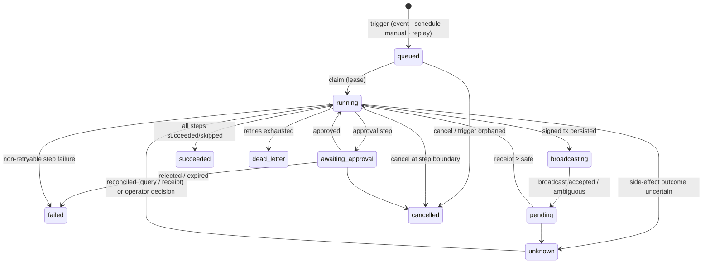

# Workflow execution state machine

Source of truth: `packages/workflow-engine/src/engine.ts`; states are declared in `packages/domain/src/workflow.ts`.

## Execution states

`succeeded`, `failed`, `cancelled`, `dead_letter` are terminal. `broadcasting`/`pending` cannot be cancelled: a signed transaction cannot be recalled, so it is followed to completion.

## Binding

Each execution stores `workflow_id`, `version` (immutable row — an SQL trigger rejects updates), `trigger_type`, `trigger_key` (event id / schedule slot / manual key), `trigger` payload, `input_hash = keccak256(canonical(trigger))`, `project_id`, `network_id`.
`execution.id = keccak256("portalforge.execution/v1|workflowId|version|triggerKey")` — the same trigger can never create two executions (`UNIQUE(workflow_id, trigger_key)`), across workers and restarts.

## Step states and attempts

`pending → running → succeeded | failed | skipped | retry_wait | waiting | awaiting_approval | unknown`.
Every real attempt writes a `step_attempts` row (worker id, input, output, error). Polling a pending transaction or an open approval is a *resume*, not a new attempt.

| Outcome | Step | Execution |
|---|---|---|
| ok | succeeded | continues |
| fail, retryable, attempts < max | retry_wait (`backoff · 2^(n-1)`, capped, ×(0.5–1.0) jitter) | running |
| fail, retryable, attempts = max | failed | **dead_letter** |
| fail, non-retryable (validation, policy, revert, budget, network mismatch) | failed | failed |
| unknown | unknown, next reconcile after backoff, or `NEVER` (operator) | unknown |
| wait / approval | waiting / awaiting_approval until time / decision | running / awaiting_approval |
| tx pending | waiting (poll) | pending |

Condition `false` → every dependent step is `skipped`; skipping propagates.

## Leases and crash recovery

- Claim sets `lease_owner`, `lease_expires_at = now + PF_LEASE_MS` and bumps `state_version`. A timer renews the lease while a step runs.
- Every state write is `WHERE lease_owner = me AND lease_expires_at >= now`; zero rows ⇒ `LeaseLost`, the worker stops touching the execution.
- A crashed worker's executions become claimable after lease expiry. Steps without side effects are re-run; side-effect steps consult their intent first.
- Per-workflow concurrency is part of the claim predicate.

Tested: `engine.test.ts` (lease death, stale writer, two workers on one DB file) and `scripts/e2e-local.ts` scenario C (real `SIGKILL` with the HTTP request in flight).

## Side effects

### HTTP (connectors)
1. Intent row (`idempotency_key = executionId:stepId`, state `prepared`) committed.
2. State `sent` committed, then the request (`Idempotency-Key: executionId`) is made.
3. 2xx → `confirmed` with response. 4xx (not 408/429) → `failed`, non-retryable. Connection refused / DNS failure → back to `prepared`, retryable (it never left the host). Timeout, reset, 5xx → `unknown`.
4. Before any retry of `sent`/`unknown`: **GET `query_url/{executionId}`**. 200 → use stored result (`reconciled: true`). 404 → receiver never processed it → resend with the same key. Error → stay unknown.
5. Connector without a query URL ⇒ an unknown outcome becomes **operator action required**; PortalForge does not resend.

What is guaranteed: no duplicate business effect **if the receiver deduplicates by executionId** (the demo service does, tested). What is not: exactly-once against arbitrary services.

### Chain writes (executor)
Only `contract_call` with `mode: write` on a registered contract **and** an enabled `contract_policies` row (nonpayable function, calls/hour, max fee). Sequence:
1. network identity check (chainId) → `eth_call` simulation → on revert, business reconciliation (e.g. `executionOf(jobId) == executionId` ⇒ already applied by *this* execution ⇒ ok; by another ⇒ conflict).
2. estimate gas/fee/balance — any RPC failure aborts (retryable); fee > policy ⇒ `BUDGET_EXCEEDED`; balance < fee ⇒ retry later.
3. nonce under a DB mutex; **sign locally** → tx hash known → intent `{tx_hash, raw_tx, nonce}` committed → `broadcasting`.
4. broadcast. Rejected by node ⇒ intent failed, key freed. Ambiguous ⇒ `unknown`, followed by hash.
5. follow: receipt ≥ safe ⇒ ok. Not mined & not in pool & nonce unused ⇒ **re-broadcast the same signed tx** (same hash). Nonce consumed by another tx ⇒ reconcile business state.

Tested on Anvil: crash after persist/before broadcast resumes with the same hash; broadcast succeeded but response lost finds the receipt; nonce count proves no duplicate tx (`chain.test.ts`).

## Approvals
Created with the execution's `state_version` and an expiry. Decisions are atomic (`state = 'pending'` predicate), refused after expiry or when the execution is no longer awaiting approval; cancel voids open approvals.

## Replay
`full`: new execution, same version and trigger payload, new id. `from-failure`: also copies outputs of steps that succeeded (`reused_from`). Contract-level dedup still applies — a full replay of a completed job fails with "applied by a different execution" (tested in unit, chain and E2E).

## Schedules
`trigger.type = schedule` creates one execution per time slot while a worker runs (`schedule:<every>:<slot>`); no catch-up storm after downtime. Contracts do not run themselves on a timer.
